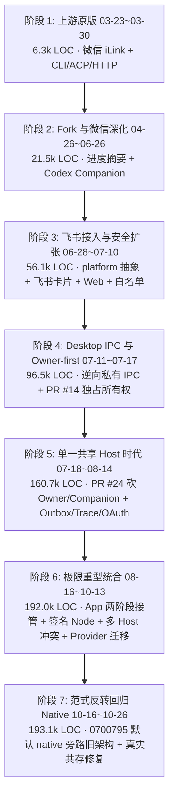

# WeClaw 全仓库 Git 历史、架构演进与历史包袱深度审计报告

> **状态**：基于本地 `main` 提交 `9161ce7`（`v0.1.325`，630 commits）及 `origin/main` 领先的 4 个提交 `ebfde7a..e1a5eb4`（`v0.1.328`，累计 **634 commits**、**55 PRs**、**329 主线 tags**）的只读考古与架构包袱审计报告。本文不是当前 authority doc；产品事实仍以 `docs/AI_CONTEXT.md` 与源码为准。
>
> **代码体量**：全仓（不含 `.worktrees`）共 **882 个 Go 文件 / 192,794 LOC**（`origin/main` 为 **193,069 LOC**，其中生产 **96,255 LOC**、测试 **96,814 LOC**，测试/生产比达 **1.006:1**），较 2026-03-23 创世版（6,299 LOC）膨胀 **30.6 倍**。

---

## 一、全局核心洞察：一场围绕“共享 Codex Host”的架构摆锤

WeClaw 在 7 个月内完成了一次典型的架构演化周期——从 **轻量微信个人号桥接器**，逐步膨胀为 **试图接管桌面 App、协调全机共享 Host、逆向私有 IPC、甚至用签名 Node 跳板绕过代码签名血缘校验的重型状态机**，最终在 2026-10-16（提交 `0700795`）完成战略反转，**回归“只做官方协议原生客户端（`native`）”**。

### 全仓代码结构与“包袱占比”量化透视

| 顶层目录 | 生产文件 | 生产 LOC | 测试文件 | 测试 LOC | 合计 LOC | 全仓占比 | 核心现状判断 |
| --- | ---: | ---: | ---: | ---: | ---: | ---: | --- |
| `messaging/` | 177 | 35,054 | 158 | 38,976 | 74,030 | 38.4% | Codex 占 35%，`terminal_outbox.go` (2,491) 与 `progress.go` (1,468) 高度膨胀，21 个飞书专属文件泄漏其中 |
| `agent/` | 142 | 30,796 | 100 | 30,468 | 61,264 | 31.8% | **包袱最重区**：Desktop IPC + App Bridge + Provider Migration 共 8,128 生产 / 7,631 测试行，在 `native` 下 100% 旁路 |
| `cmd/` | 65 | 10,728 | 45 | 9,627 | 20,355 | 10.6% | 含 1,945 行重启/旧服务强杀协调逻辑、582 行 Companion 与 130+ 行纯死重启校验函数 |
| `feishu/` | 35 | 8,552 | 42 | 9,867 | 18,419 | 9.6% | 高质量 CardKit/去重体系，但残留 ~260 行折叠按钮、103 行回复串与 55 行单 Bot 死 API |
| `config/` | 7 | 1,404 | 11 | 1,904 | 3,308 | 1.7% | 堆积 7 组废弃/兼容字段；`detect.go` 仍在为 `native` 自动写入失效的 `codex_auto_update` |
| `codexauth/` | 14 | 1,794 | 4 | 720 | 2,514 | 1.3% | 严谨的凭据隔离设计，但绑定旧 shared-host 切号模型且受 macOS Keychain 4 KB 上限困扰 |
| `wechat/` + `ilink/` | 14 | 2,530 | 9 | 1,832 | 4,362 | 2.3% | 发源地最紧凑，但缺失多账号 `Route` 隔离，附件下载泄漏到业务层 |
| `api/` + `web/` + `platform/` + `observability/` + `internal/` | 37 | 5,375 | 21 | 3,160 | 8,535 | 4.4% | **工程质量最高区**：SSRF/CSRF/安全文件/脱敏 Trace 基线极强，仅含少量旧端点和 Windows 空壳 |
| **合计** | **492** | **96,240** | **390** | **96,554** | **192,794** | **100%** | — |

> **关键数字**：`0700795` 回归 `native` 时采取了**非破坏性旁路降级**（仅新增 1 个 24 行文件 `agent/codex_native_client.go` 与若干模式分支），导致历史四代架构的几乎全部代码原封不动留在了仓库中。经逐文件核查：
> - **纯死代码 & 失效假实现（零风险可立即删除）**：约 **~1,500+ 生产 LOC** + 大量配套测试 + 本地工作区未跟踪构建残留。
> - **已被 `native` 旁路但仍为显式旧模式留存的重型架构体**：约 **~11,000+ 生产 LOC + ~9,500+ 测试 LOC**（含 `scripts/codex-provider-switch.sh` 1,879 行），合计超过 **22,000 行代码**。

---

## 二、Git 历史七阶段演变、关键 PR 与架构动荡热点

### 2.1 七阶段演化量化表

| 阶段 | 时间跨度 | Commit 区间 | 提交数 (主线/Merge) | 主线 Tags | 累计变更 `--no-merges` | 阶段末 Go LOC (生产 / 测试) | 关键架构跃迁 |
| --- | --- | --- | ---: | ---: | --- | --- | --- |
| **1. 上游原版** | 03-23 ~ 03-30 | `571ad32..10711d0` | 59 (52 / 6) | 0 | +7,945 / -495 | 6,299 (5,723 / 576) | `idoubi` 创世：微信 iLink + CLI/ACP/HTTP + PR #16 接入 `codex app-server` |
| **2. Fork 与微信深化** | 04-26 ~ 06-26 | `10711d0..98a78b4` | 68 (68 / 0) | 55 | +19,386 / -1,582 | 21,473 (14,047 / 7,426) | 接手演进：微信进度摘要、Codex 两级浏览、Companion 可见终端、Claude 会话复用 |
| **3. 飞书接入与管控扩张** | 06-28 ~ 07-10 | `98a78b4..5520acf` | 141 (125 / 10) | 100 | +64,144 / -25,506 | 56,090 (32,517 / 23,573) | 抽离 `platform/`，接入 `feishu/`、多机器人、`web/` 面板、白名单/审批，首次大拆文件 (`79b766b`, `6b16caf`) |
| **4. Desktop IPC 与 Owner-first** | 07-11 ~ 07-17 | `5520acf..1807819` | 179 (123 / 4) | 52 | +62,360 / -14,614 | 96,471 (49,801 / 46,670) | 单日 14 连发逆向 Codex Desktop IPC；全面删 Claude CLI 转 ACP；PR #14 (54 子提交) 推向独占所有权顶峰 |
| **5. 单一共享 Host 时代** | 07-18 ~ 08-14 | `1807819..31ebdfd` | 111 (111 / 0) | 72 | +90,993 / -32,974 | 160,726 (82,679 / 78,047) | PR #24 推翻 Owner 与 Companion；建 `codexauth/`、`observability/`、`terminal_outbox`、官方 daemon、协调重启、双源发布 |
| **6. 极限重型统合** | 08-16 ~ 10-13 | `31ebdfd..5259bc8` | 70 (68 / 1) | 47 | +38,291 / -5,925 | 192,029 (96,050 / 95,979) | `codex_multi_frontend`、`shared` 模式（签名 Node + `launchctl` + MCP pipe）、多 Host 冲突预检、Provider 迁移、两阶段打包发布 |
| **7a. 回归 Native Client** | 10-16 | `5259bc8..9161ce7` | 2 (2 / 0) | 1 | +1,139 / -433 | 192,794 (96,240 / 96,554) | `0700795` 标准 `auto→native` 旁路 App 接管/IPC/冲突扫描/Provider 改写；Go 升 1.26.9 |
| **7b. Native 真实打磨** | 10-25 ~ 10-26 | `9161ce7..e1a5eb4` | 4 (4 / 0) | 2 | +287 / -12 | 193,069 (96,255 / 96,814) | `origin/main` 领先 4 提交：仅改 15 行生产逻辑 + 267 行测试，打磨多端共存只读接续与断线重连 |

### 2.2 决定项目命运的 Top 12 关键 PR / 里程碑提交

| 日期 | Commit / PR | 规模 (文件 / 增删) | 架构转折意义 |
| --- | --- | --- | --- |
| 03-25 | `8a11548` (上游 PR #16) | 2 / +290 -13 | 为 ACP Agent 接入 `codex app-server` 协议，埋下后来全部 Codex 演进的种子 |
| 06-28 | `41685af` | 74 / +7,969 -1,063 | 抽离 `platform/` 抽象并接入 `feishu/`，WeClaw 从“微信工具”跃迁为“跨平台 IM 中枢” |
| 06-30 | PR #1 ~ #5 (`b0b8a86..471168e`) | 50 / +3,423 -23 | 一天连合 5 个 PR，确立超时强杀、`/mode`/`/stop`/`/ps`、`doctor`、`web/` 面板、安全基线 |
| 07-11 | `671a354..3d66427` (14 连发) | ~25 / +4,500+ | 逆向并实现整套 Codex Desktop 私有 IPC 协议栈（24 个生产文件），试图实时接管桌面端 |
| 07-13 | `996f444` (序列) | 20+ / 大重构 | 删除 Claude CLI 后端（`agent/cli_claude.go`），确立 Claude ACP-only 路线 |
| 07-15 | `da082e3` (**Fork PR #14**) | **111 / +13,694 -1,372** | **全史最大 PR**（54 子提交）：Codex + Claude “选择即独占接管”原子事务——但仅 3 天后即被推翻 |
| 07-18 | `f98ec09` (**Fork PR #24**) | **133 / +2,798 -6,214** | **首次大瘦身与范式转换**：Codex 收敛为单一共享 app-server，铲除 Companion 与 `codex_control_store` |
| 07-19 | `6dee220` + `c47374c` | 161 / +8,084 -3,099 | 同日完成 Claude 单一共享 Host 重构 + `codexauth/` 多账户安全切换子系统 |
| 07-20 | `0a58e40` | 96 / +5,047 -325 | 奠定 `observability/` 端到端脱敏 Trace 与 `messaging/terminal_outbox.go` 终态可靠交付基石 |
| 08-11 | `54d3ca1` | 149 / +7,408 -1,112 | 引入 `codex_follower.go` 协作接力；同步废除 `admin_users`，权限统一收敛到账号级 `allowed_users` |
| 09-01 | `d34012c` | 68 / +3,723 -1,758 | **核心理念转变**：放弃“写入权移交门禁”，确立“binding 只表示窗口选择，每次按权威 `thread/read` 走 `steer`/`start` + 审批 broker” |
| 10-16 | **`0700795`** (`v0.1.325`) | 51 / +1,135 -429 | **第二次范式转换（回归 Native）**：标准 `auto` 默认解析为 `native`，退出 App 启动接管、Desktop IPC、全机冲突扫描与 SQLite Provider 改写 |

### 2.3 代码动荡热点（Churn Top 10）揭示的架构痛点

| 排名 | 生产文件 | 修改次数 | 累计变更行 | 当前行数 | 重写倍数 | 反复震荡根因 |
| ---: | --- | ---: | ---: | ---: | ---: | --- |
| 1 | `messaging/handler.go` | **125** | 10,114 | 214 | 47× | 业务总入口，每次能力扩张先堆入再被迫拆分 |
| 2 | `agent/acp_agent.go` | **77** | 6,117 | 233 | 26× | 单体 ACP 被拉扯为 100+ 文件的 Codex/Claude 多模态宿主 |
| 3 | `cmd/start.go` | **55** | 2,116 | 240 | 8.8× | 启动预检随多平台/API-only/共享 Host 反复加减 |
| 4 | `config/config.go` | **47** | 1,259 | 445 | 2.8× | 配置开关随路线摇摆不断新增、废弃、兼容保留 |
| 5 | `messaging/codex_external_task.go` | **40** | 1,006 | 498 | 2.0× | 外部 App/CLI 任务感知与终态边界，直至 `d438c10` 仍在补丁 |
| 6 | `feishu/adapter.go` | **38** | 1,197 | 299 | 4.0× | 多机器人、重连、回复串进退、防重放高频调整 |
| 7 | `messaging/codex_session_acquire.go` | **36** | 1,384 | 630 | 2.2× | 会话获取先后叠加 Owner、Handoff、Provider 迁移、Follower、ResultReplay |
| 8 | `messaging/task_state.go` | **35** | 1,603 | 563 | 2.8× | 任务三态收敛与跨重启状态恢复核心状态机 |
| 9 | `messaging/progress.go` | **34** | 2,402 | 1,468 | 1.6× | 叠加摘要/流式/5条折叠/接力重锚/Outbox 多套双轨 |
| 10 | `agent/codex_runtime_probe.go` | **32** | 1,372 | 758 | 1.8× | Desktop/Daemon 探活、有界分页与最新 `e1a5eb4` 断线重连 |

### 2.4 17 项“被引入 → 反复修补 → 推翻/废弃”的特性墓志铭

| # | 被推翻/废弃的特性 | 引入 → 终结/转向提交 | 存活期 | 残留在当前仓库中的后遗症 |
| ---: | --- | --- | --- | --- |
| 1 | **飞书回复串子会话** | `2938094` → `919a362` (07-06) | **< 24 小时** | `feishu/sender_reply.go` (103 行) 与两处异常处理仍触发 `ReplyInThread(true)` |
| 2 | **Codex 首轮写入猜测** | `fda32c1` → `caaa137` (07-17) | **数小时** | 文件已删，规则已固化 |
| 3 | **Codex/Claude Owner-first 独占所有权** | `946ca1f`/`da082e3` → `f98ec09`/`b20be2f`/`6dee220` | **4 天** | `enforceControl` 在生产恒 `false` 却留 18 处分支；`messaging/` 仍伪造 `owner=remote revision=1`；`/cc owner` & `/cc cli` 禁用壳 |
| 4 | **自定义文件/命令进度解析器** | `b15db1b` → `ef04bfe` (PR #40) | **24 天** | 3 个文件已干净删除 (-1,301 行) |
| 5 | **飞书进度卡“最近 5 条折叠 + 展开按钮”** | `d17ddd8`/`6239abf` → `24bb71b` | **34 天** | 生产恒 `Preview == Details`，但残留 ~260 生产 LOC + ~450 测试 LOC（含 `feishu/task_progress_control.go` 整文件） |
| 6 | **飞书 `admin_users` 管理员体系** | `4c61a03`/`aa76335` → `54d3ca1` | **37 天** | `LegacyAdminUsers` 告警保留；且导致现行“所有白名单用户皆主机管理员”的扁平信任模型 |
| 7 | **Codex Companion 可见终端 & attach/detach** | `7cac628` → `f98ec09` (PR #24) | **52 天** | Codex Companion 已删，但 `companion` 框架仍留 1,377 生产 LOC 专供 OpenCode；`/cx attach|detach` 禁用分支残留 |
| 8 | **`allowed_workspace_roots` 目录白名单** | `6c0c3be` → `881cd74` | **55 天** | `workspace_access.go` 已删；`LegacyAllowedWorkspaceRoots` 承诺只兼容 1 版却已滞留 38 版 |
| 9 | **`codex_multi_frontend` & `shared` App 启动接管** | `7fb8e06`/`de68840` → `0700795` | **61 天** | 退出默认路径，但 `agent/codex_app_bridge.go` 等 2,105 生产 LOC + 签名 Node 脚本留作显式兼容 |
| 10 | **Codex 历史 thread Provider 自动迁移** | `03bade5`/`f10c6ec` → `0700795` | **68 天** | `native` 已短路禁用，但 Go 迁移 1,579 LOC + 孤立脚本 `scripts/codex-provider-switch.sh` 1,879 LOC 仍双轨滞留 |
| 11 | **Codex Desktop IPC 作为默认/权威 Host 与旧 thread 回交** | `671a354` → `0700795` | **97 天** | `native` 彻底关闭协调，但 24 个生产文件 **4,444 生产 LOC + 5,810 测试 LOC** 留作旧模式兼容 |
| 12 | **npm Codex 复用受控 Host & CLI 自动更新** | `d8950fa` / `cde0966` → `0700795` | **44~83 天** | `agent/codex_cli_auto_update.go` (230 LOC) 仅 `managed` 生效，但 `config/detect.go:208-213` 仍在为 `native` 自动写入 `"incompatible"` |
| 13 | **Codex `type: cli` (`codex exec`) & Claude CLI** | `571ad32` → `996f444` / `5d8522e` | **112~138 天** | 专属实现已删，留 `NormalizeCodexRemoteFirst` 与 Claude 非 ACP 拒绝护栏 |
| 14 | **Windows / 6 平台发布矩阵** | `4f4f75e` → `0dbd73f` → `6f8fc9c` | **100 天** | 发布已锁死 `darwin/arm64` + `linux/amd64`，但全仓留 **19 个失效/安全跳过 Windows 文件 (553 LOC)** |
| 15 | **微信端 Codex 切号（砍后重建）** | `3fc386d` → `862164b` → `c47374c` | — | 已用独立 `codexauth/` 重建为严谨的 shared-host 级多账户体系 |
| 16 | **启动默认即微信扫码** | `571ad32` → `99fc220` | **154 天** | 已改为 API-only 默认常驻；旧凭证迁移逻辑在 `cmd/` 和 `web/` 重复实现 3 处 |
| 17 | **飞书重启旧消息跳过聊天通知** | `9b42cda` → `3305c17` | **65 天** | 已静默为脱敏日志，消除群聊刷屏 |

### 2.5 `origin/main` 领先 4 提交（`v0.1.325 → v0.1.328`）折射的新路线

1. **`ebfde7a`**：修复 macOS 中文 locale 下 `ps -o lstart=` 带 `"月"` 后缀导致 `agent/codex_process_start.go` 身份校验误判。
2. **`5bab483` (`v0.1.326`)**：响应标准库证书漏洞，将 Go 工具链对齐升级至 `1.26.10`。
3. **`d438c10`**：回归 `native` 后真机暴露的关键场景——当官方 App 用独立 stdio 运行任务时，WeClaw daemon 对 `thread/read` 返回 `notLoaded` 不再误判为任务已结束；只读 rollout 观察也不再触发 daemon 订阅或抢占 writer。
4. **`e1a5eb4` (`v0.1.328`)**：给 `agent/codex_runtime_probe.go` 的只读/绑定 RPC 入口补上 `ensureStarted(ctx)` 断线静默重连，附带 147 行高并发防退化单测。

> **结论**：这 4 个提交仅改动 **15 行生产代码**，却配套了 **267 行精准回归测试**，标志着项目已彻底走出“重型进程统合”泥潭，进入围绕 **原生多端共存 + 诚实能力边界** 精细打磨的健康阶段。

---

## 三、第一类：有意为之的高价值核心设计（不可误删）

在讨论瘦身前，必须明确区分哪些复杂性是 **本质复杂性（Essential Complexity）**。WeClaw 的工程防御深度远超同类个人桥接项目，以下五大体系属于**核心资产**：

### 1. 纵深安全边界体系（`api/`、`internal/`、`web/`、`observability/`）
- **三层 API 鉴权**（`api/auth.go`）：只读、发送（按真实 TCP `RemoteAddr` 限流）、本机控制（强制真实 loopback TCP + Host/Origin 校验防 DNS rebinding/CSRF + 恒定时间 Token 比对）。
- **DialContext 级 SSRF 防护**（`internal/remotefetch/remotefetch.go`）：禁用代理、屏蔽 16 个特殊用途 IPv4/IPv6 CIDR、在真正拨号阶段解析并校验全部 DNS 结果后直连已验证 IP、重定向逐跳重检、25 MiB 硬上限。
- **防 TOCTOU 与符号链接攻击的安全文件原语**（`internal/securefile/securefile.go`、`internal/accountstore/lock.go`、`observability/secure_io_unix.go`）：目录 `0700` / 文件 `0600`、`O_NOFOLLOW` + UID 核验、目录 fd (`openat`/`renameat`) 防竞态、同目录临时文件 `Sync + Rename + dirSync` 原子写入、持久锁文件跨进程 `flock`。
- **配置持久化与防环境变量泄漏**（`config/persistence.go:89-127`）：`config.Update` 持进程内+跨进程锁重读最新快照，并捕获还原 env-backed 值（确保 `WECLAW_API_TOKEN` 绝不落盘）；`web/` 采用 URL fragment 传 Token + 立即擦除 + 乐观锁 revision + `__WECLAW_UNCHANGED__` 掩码。

### 2. 进展快照与终态投递分离的可靠性架构（`messaging/` + `observability/`）
- **单一视图 Reducer**（`messaging/task_view_reducer.go`）：任务卡、`/ps`、续卡、重锚共享同一纯函数状态视图，终态水位线后拒绝旧 sequence 与晚到 watcher。
- **持久化 Terminal Outbox**（`messaging/terminal_outbox.go`）：区分“可覆盖的进度快照”与“不可丢的终态结果”，提供基于稳定平台 UUID / CardKit sequence 的 at-least-once 交付、跨重启恢复、旧卡 supersede 补偿重试与脱敏运维查询（`weclaw outbox status/redrive`）。
- **固定字段脱敏端到端 Trace**（`observability/trace.go`、`observability/protocol.go`）：入站消息→任务→turn→进度→终态全链关联，路由键不可逆哈希，禁止任意 map 写盘，协议正文默认关闭。

### 3. 原生多端协作核心协议边界（`agent/`）
- **无独占门禁的权威调度**（`agent/codex_runtime_turn.go`）：每次按权威 `thread/read` 决定 `active → turn/steer(expectedTurnId)` / `idle → turn/start`，状态竞态有界重读且只提交一次。
- **未知交付绝不盲重试**（`agent/codex_input_delivery.go`）：写后断线/超时用 turn/items 基线与摘要核对，无法证明时不自动重发、不保存完整输入。
- **唯一交互 Broker**（`agent/codex_interaction_broker.go`）：多 route 各自展示审批/问答，按 `(thread, turn, request)` 串行唯一提交，`serverRequest/resolved` 让其余卡片收敛。
- **有界分页历史读取**（`agent/codex_runtime_probe.go`）：`thread/resume(excludeTurns=true)` + `thread/turns/list` + `thread/items/list` 分页加载，防止超大会话撑爆 64 MiB JSON-RPC 帧上限。
- **真实隔离官方 Daemon 协议门禁**（`agent/codex_daemon_live_protocol_test.go`）：独立复制完整 standalone 包并隔离 `HOME`/`CODEX_HOME`/`PATH` 验证双客户端真实协议。
- **严格进程身份核验与优雅排空**（`agent/codex_daemon_host.go`、`agent/codex_host_conflict_stop_unix.go`、`cmd/start_runtime.go`）：发信号前复核实时 UID/PGID/启动时间/exe/argv，绝不按进程名盲杀；启动前强制校验 `RecoverRuntimeRestart` pending 记录；`context.WithoutCancel` 防止平台回调取消误杀后台任务；`/stop` 独立三态终态。

### 4. 企业级飞书交互细节（`feishu/`）
- 多机器人按 `app_id` 隔离、身份分离（真实发送者 vs session route）、持久化去重 + 话题群镜像去重（`feishu/mirror_dedup.go`）、分页服务端快照防重复点击失效、CardKit 软上限预检自动分段续卡、每次引导生成接力卡。

### 5. 工业级双阶段发布与安全自更新闭环（`scripts/` + `cmd/update*.go`）
- `scripts/release.sh` 作为本地与 CI 的唯一权威入口；`package`（10 项全量门禁 + `.package.json` 摘要固化）与 `publish`（严禁重编译、Draft Release + 上一版 `weclaw update` 自更新烟测、失败回滚）严格解耦；GitHub 权威 + Gitee 确定性 `.gz` 镜像 + `scripts/gitee_retention.py` 核验备份后保留最近 3 版的配额治理；`cmd/update_local.go` 原子替换与预检失败回滚。

---

## 四、第二类：明确的历史遗留与显式兼容层（有阶段性价值，需设退场计划）

这一类代码不是“错误”，而是架构迭代过程中为了 **兼容旧配置、旧磁盘状态、旧版本平滑升级、以及显式保留旧运行模式作为 `native` 回退保险** 而刻意保留的兼容层。它们构成了当前仓库最大的认知与维护负担。

```mermaid
flowchart LR
    subgraph Native["当前默认路径: auto → native"]
        N1["codex_native_client.go (24 LOC)"]
        N2["codex_daemon_host.go (目标校验)"]
        N3["codex_runtime_turn / broker / probe"]
        N4["messaging binding + follower + outbox"]
    end

    subgraph LegacyModes["已被 native 100% 旁路的显式旧模式体 (~11k+ 生产 LOC)"]
        L1["Desktop IPC 协议栈<br/>24 文件 · 4,444 生产 / 5,810 测试"]
        L2["App Bridge & Shared Launchctl<br/>8 文件 + 2 JS · 2,105 生产 / 1,417 测试"]
        L3["Provider SQLite 自动迁移<br/>6 Go 文件 1,579 + 2 Shell 脚本 1,879"]
        L4["全机多 Host 冲突扫描 & CLI 自动更新<br/>codex_host_conflict 预检 + auto_update 230"]
        L5["messaging & cmd 旧模式适配<br/>Deferred/RecoveryResult/CLI 租约 API ~800"]
    end

    Native -. "仅显式配置 shared / daemon / managed 时进入" .-> LegacyModes
```

### 1. Codex 三大显式旧 Host 模式（`shared` / `daemon` / `managed`）庞大支撑体
在 `agent/codex_daemon_host.go:74-83` 与 `agent/acp_constructor.go:119-125` 确立标准 `auto → native` 后，以下模块在默认配置下**完全不执行**：
- **Codex Desktop IPC 逆向协议栈**（`agent/codex_desktop_*.go`，**24 生产文件 / 4,444 LOC + 16 测试文件 / 5,810 LOC = 10,254 LOC**）：占 `agent/` 全包的 16.7%。`native` 和 `shared` 均将 `codexDesktopCoordination = false`、`codexDesktopHostSelection = false`，仅显式 `daemon`/`managed` 或测试注入使用。
- **App 两阶段启动接管与签名 Node 桥接**（`agent/codex_app_bridge.go`、`agent/codex_app_daemon_reuse_darwin.go`、`agent/codex_app_bootstrap.go`、`agent/assets/codex_app_host.cjs`、`agent/assets/codex_app_mcp_env.mjs`、`cmd/codex_app_bridge.go`，合计 **2,177 生产 LOC + 1,417 测试 LOC**）：为绕过 App 进程血缘代码签名校验而构建的桥接体系。目前仅 `weclaw codex app --restore` 是一次性退出迁移的必要工具，其余全为旧 `shared` 兼容。
- **历史 Thread Provider 自动改写**（`agent/codex_provider_migration.go` 1,011 LOC、`agent/codex_provider_runtime.go:50-54` 等 6 文件 **1,579 生产 LOC** + 孤立脚本 `scripts/codex-provider-switch.sh` 及测试 **1,879 LOC**）：`native` 直接短路跳过，不再直接改写 Codex 私有 SQLite。
- **全机多 Host 冲突扫描与 CLI 自动更新**：`agent/codex_host_conflict.go:879-884` 在 `native` 下直接 `return nil`（该文件 1,263 LOC 中，对 `native` 仍有用的主要是显式 `--force` 时的进程身份复核与安全终止原语）；`agent/codex_cli_auto_update.go:66-68` (230 LOC) 仅 `managed` 生效。
- **配套 CLI / API / Messaging 旧模式路径**：`api/codex_cli.go` (`/api/codex/cli/prepare`)、`cmd/codex_cli.go:77-174` 服务租约与非 native 分支、`cmd/start_runtime.go:141-212` 启动预热、`cmd/start.go:170-183` `preflightCodexMultiFrontend`，以及 `messaging/` 中约 400–600 行的 `Deferred` / `RuntimeRecoveryResult` / Desktop 报错文案 / 5 层旧 Watch 接口断言。

### 2. 旧版无协调接口服务升级过渡层（~550+ 生产 LOC）
- `cmd/restart_safety.go:174-276`（404 降级调旧 `/api/runtime/drain`）、`api/server.go:306-350`（旧 `/api/runtime/drain` 端点）、`cmd/legacy_force.go` + `cmd/legacy_force_process*.go`（534 LOC）+ `cmd/testdata/legacy_runtime/`。
- **耦合现状**：`legacy_force` 目前被兼用作“服务未运行时的离线 `--force` 清理与 pending 恢复入口”。一旦旧版本升级窗口过去，把“离线 `--force`”拆成轻量函数即可整体退场 500+ 行旧服务接管代码。

### 3. 旧配置字段、迁移逻辑与隐藏兼容命令
- `codex_multi_frontend`、`codex_app_reuse_daemon`（`config/config.go:85-89`）：`native` 下 `Effective*()` 恒返回 `false`，仅做 JSON round-trip 兼容，但 `web/view.go` 仍维护完整透传。
- `LegacyAdminUsers`（`admin_users`，`config/config.go:20`）：运行时忽略、启动/doctor 告警防误解。
- `NormalizeCodexRemoteFirst`（`config/detect.go:186-268`）：自动把旧 Codex `companion`/`cli` 配置迁移至 `app-server`。
- 微信旧凭证隐式启用迁移（`platforms.wechat.enabled == nil`）：在 `cmd/start_platform.go:25-77`、`cmd/start_config_reload.go:185-191` 和 `web/status.go:64-69` **重复实现了 3 份**。
- 隐藏 CLI 命令：`weclaw feishu login`、`cmd/feishu_bootstrap.go`（已被 `feishu add` 统一，但 `add` 复用其底层函数）。

### 4. 状态文件跨代迁移代码与双轨机制
- **`codex-sessions.json`（已至 v15）**：`messaging/codex_session_persistence.go` 中保留 ~90 行 v1–v3 `Controls` / 裸微信 key 迁移；v14 `preparing/ready`（~220 行，已不再授权写入，仅充当 Outbox 投递延迟门禁与 `/cx status` 展示）；v15 同时存在 `PresentedResultTurns`（非飞书）与 `ResultReplay`（飞书 Outbox）两套“空闲结果去重”机制。
- **`claude-sessions.json`（v1→v4）**：`messaging/claude_session_persistence.go:44-95`（52 行迁移代码）及只剩 1 行版本常量的 6 行文件 `messaging/claude_control_store.go`。
- **`terminal_outbox.go` v1 兼容**：`messaging/terminal_outbox.go:580-590` 启发式文本识别旧活跃恢复草稿，以及 `StatefulDurableStreamTerminalPreparer`→`DurableStreamTerminalPreparer`、`IdempotentResultReplier`→`IdempotentTextReplier` 双重接口降级。
- **`wechat/token_store.go`**：`wechat/token_store.go:168-192` 旧无 `_weclaw_bot_id` 文件的扫描碰撞校验（25 行）。

### 5. `feishu_session_key` vs `IncomingMessage.Route` 双写双读
- 跨 12 个生产文件 14 处引用，`messaging/handler.go:168` 和 `feishu/session_scope.go:11` 各定义一份常量；根因是 `platform.Choice` 缺乏平台无关路由字段，且 `feishu/approval_waiting.go:35` 硬编码检测 `strings.Contains(..., ":group:")` 判断群聊。

### 6. Codex 多账户热切体系（3,964 生产 LOC）
- 横跨 `codexauth/` (1,794)、`agent/codex_account*.go` (1,423)、`messaging/codex_account*.go` (747) 和 `cmd/codex_account.go` (551)。本质是为“唯一受管 shared Host 轮换 OAuth 身份”设计，在 `native` 模式下普通输入不再自动重启切号；且实测 macOS Keychain 存在 4096 字节 CLI 上限缺陷（09-07 审查 P0-5）。

### 7. 处于“暂停态”的 Claude 子系统与 Codex 的高度镜像重复
- `tasks/todo.md:5` 明确标注 Claude 工作暂停；其代码（`messaging/claude_*.go` 2,743 LOC + `agent/claude_*.go` 1,483 LOC）停留在 07-19 世代，但与 Codex 在 **顺序多锁（95% 逐行复制）、飞书二级分页卡片（~80%）、重命名（~75%）、模型覆盖（~70%）** 上高度重复，甚至直接借用 `codexWorkspaceView`、`shortCodexWorkspaceName`、`codexSessionLockWaitTimeoutValue` 等 Codex 内部符号。

### 8. 仅剩 OpenCode 使用的 Companion 体系（1,377 生产 LOC）
- `agent/companion*.go` (795 LOC) + `cmd/companion.go` & `cmd/opencode_companion*.go` (582 LOC)。Codex Companion 已明确硬禁止，Claude 走 ACP，目前全仓仅 `opencode` 使用且主文档几乎无曝光。

---

## 五、第三类：为已不存在的问题而存在、可安全移除的历史包袱（三级清理清单）

按**风险由低到高、确定性由强到弱**，整理为可直接落地的三级清理清单。

### Tier 1：零风险立即可清（纯死代码、工作区脏资产、明显配置 Bug）

| # | 目标位置 | 体量 / 占用 | 实证依据（为何可 100% 安全移除） |
| ---: | --- | --- | --- |
| **1** | **本地未跟踪脏资产**：`dist/` 堆积的 218 个历史发布包、`tmp/` 残留二进制、根 `./weclaw` 旧二进制、`.codegraph/`、`.superpowers/sdd/`、`output/images/` 下滞留的本地图片、已完全合入的 `.worktrees/feishu-progress-card-relay` + 分支 `feat/feishu-progress-card-relay` + `git worktree prune` | **~12.1 GB** | 全部为本地构建/审查残留；`feat/feishu-progress-card-relay` 已 100% 合入 `main`（`git log main..branch` 为空），另存在 1 条 `prunable` 僵尸 worktree 记录 |
| **2** | `.kiro/` 目录（2 个 `.config.kiro` 空壳） | 2 文件 | Git 跟踪的早期 IDE 残留，无任何 spec 正文 |
| **3** | `messaging/markdown.go` | **101 LOC** | **全仓 0 引用死文件**（生产与测试均无调用）；微信实际使用已加固的 `wechat/markdown.go` |
| **4** | `agent/codex_runtime_recovery.go:12-34,122-146` + `agent/codex_app_server_gate.go:14,128-194` | **~120 LOC** | `restartCodexAppServer`、`restartCodexAppServerUnsafe`、`stopCodexAppServerProcess`、`gate.drain/beginDrain/waitUntilIdle/markRestarting/abortDrain` 及状态 `codexAppServerRestarting` **全仓 0 生产调用** |
| **5** | `agent/codex_host_conflict.go:895-900` `StopConflictingCodexHosts` | ~15 LOC | `53da91b` 统一收口至 `--force` 后，该方法全仓 **0 生产调用**（连同 `CodexRestartOptions.StopConflictingCodexHosts` 可一并评估移除） |
| **6** | `cmd/restart_safety.go:56-89,317-352` + `cmd/restart.go:198-207` | **~130 LOC** | `ensureConfiguredRestartSafe`、`ensureRestartSafe`、`ensureRestartSafeWithConfig`、`fetchRuntimeStatus`、`runtimeStatusURL` **全仓 0 生产调用**（早已被 `/api/runtime/restart/prepare` 取代） |
| **7** | `feishu/config.go:20-21,45-125,188-199` | **~55 LOC** | 旧单 Bot 凭证 API (`LoadCredentials`/`SaveCredentials`/`CredentialsPath` 等) **全仓 0 生产调用** |
| **8** | `messaging/` 零散死代码群：`messaging/codex_runtime_binding.go:149-156` (`guardCodexThreadSwitch` 空壳)、`messaging/codex_thread_release_store.go:127-153` (`rollbackWorkspaceThreadRelease` 0 生产调用)、`ownerBindingKey` 僵尸字段透传（跨 4 个文件最终 `_` 丢弃）、`messaging/codex_session_acquire.go:192-194` 不可达分支、`messaging/progress.go:184-220` 前 4 层 0 调用包装、`messaging/remote_media.go:15-28`、`messaging/terminal_outbox.go:232` 测试钩子 `deliveryAllowed` | **~140 LOC** | 均为重构残留的空壳、死透传或仅旧单测调用的包装函数 |
| **9** | `wechat/replier.go:146-148,190-234` (`textStream`) | **48 LOC** | 微信 `Capabilities().Streaming == false`，`progress.go` 永不调 `OpenStream`，生产不可达 |
| **10** | `api/server.go:31,159` (`Server.clients`) & `web/auth_throttle.go` | ~40 LOC | 正式入口固定传 `nil`；`web/auth_throttle.go` 仅为单行别名封装 |
| **11** | **逻辑脱节与配置 Bug 修复**：`config/detect.go:208-213`（停止为 `native` 自动写入 `codex_auto_update: "incompatible"`）、`service/com.fastclaw.weclaw.plist` & `Dockerfile`（均缺 `--foreground` 会导致 launchd 死循环 / 容器即退）、`scripts/release.sh:60`（硬编码本机缓存根目录路径与 `:202` `.exe` 死分支）、`cmd/doctor_platform.go:92`（拼写 `allow_users`）、`web/static/app.js:54`（过时文案“本地交接”） | 小改高收益 | 均为已实证的过时配置缺陷或本机路径泄漏 |

### Tier 2：低风险高收益瘦身（已推翻特性残留、虚假跨平台壳、过时文档/脚本）

| # | 目标包袱 | 精确体量 | 为何属于“解决已不存在问题的包袱” |
| ---: | --- | --- | --- |
| **1** | **19 个 Windows / `!unix` 失效或安全跳过壳文件** + 9 处 `.exe`/`rundll32` 残留（`agent/*_windows.go`, `cmd/*_windows.go`, `codexauth/*_other.go`, `internal/securefile/*_other.go`, `observability/secure_io_other.go`） | **553 生产 LOC** (19 文件) | 发布矩阵自 `0dbd73f` / `6f8fc9c` 起早已锁定 `darwin/arm64` + `linux/amd64`；`internal/securefile/lock_other.go` 直接报错且 `Signal(0)`/`0o600` 在 Windows 必败。多个 `*_other.go` 反而提供“跳过 owner / 无 `O_NOFOLLOW`”的虚假不安全实现，清理后可消除跨平台错觉 |
| **2** | **飞书进度卡“最近 5 条折叠 + 展开/收起按钮”兼容残留**（`feishu/task_progress_control.go` 整文件 + `feishu/card.go` / `feishu/task_card.go` / `feishu/stream.go` / `messaging/progress.go`） | **~260 生产 LOC + ~450 测试 LOC** | `24bb71b` 已于 2026-09-16 取消折叠，生产恒 `Preview == Details`，旧折叠卡生命周期早已过期，继续背负双份内容字段与按钮回调已无必要 |
| **3** | **生产恒为 `false` 的 `enforceControl` 旧所有权门禁**（`agent/codex_desktop_owner.go:19`、`agent/codex_runtime_lease.go`、`agent/codex_runtime_reconcile.go` 18 处分支）+ `messaging/` 伪造 `codexSharedHostIntent` 及 `/cx status` 无意义打印 `owner=remote revision=1` | **~200 生产 LOC** | 任何生产配置下 `enforceControl` 都为 `false`，仅服务旧单元测试；剥离后可彻底清理 Owner-first 幽灵术语 |
| **4** | **飞书回复串异常处理残留**（`feishu/sender_reply.go` 103 LOC + `feishu/adapter_events.go:128,155` + `DeliveryRoute.ReplyToID`） | **~130 生产 LOC** | 回复串子会话存活不到 24 小时即在 `919a362` 砍掉，现存 2 处错误回复反而违背 L152 注释意外创建回复串 |
| **5** | **孤立脚本 `scripts/codex-provider-switch.sh` + `scripts/codex_provider_switch_test.sh`** | **1,879 LOC** | 文档零提及、CI/发布零运行、与 Go 迁移格式不兼容且存在热 WAL 竞态；`native` 已不再改写 SQLite provider |
| **6** | **`config.LegacyAllowedWorkspaceRoots`**（`config/config.go:19`）与 **3 份历史过时 Specs**（`docs/superpowers/specs/2026-{07-18,08-06,08-08}*.md` 合计 789 行） | ~800 行 | `LegacyAllowedWorkspaceRoots` 注释写明仅兼容 1 版却已滞留 38 版（除非决定采纳 09-07 P1-7 重新启用 `/cwd` 约束）；3 份历史 spec 已按 `docs/README.md:66` 原则被取代，Git 历史永久可查 |
| **7** | **过时命令文案与离线 `restart` 冗余租约检查**（`cmd/stop.go`、`cmd/restart.go:101-107`、`cmd/update.go`） | 文案与小段逻辑 | `native` 模式下离线 `restart` 仍在抢 `CodexRestartLease` 并提示“退出所有 `weclaw codex cli`”，但 `native` CLI 根本不持有该租约；帮助文案仍写旧共享 Host 语义 |

### Tier 3：战略架构减负（待 `native` 真实前端验收稳定后分步落地）

一旦 `native` 模式完成真实 Codex App / 飞书 / 微信验收，决定不再维护旧共享接管体系，可按以下顺序卸下 **> 12,000 行生产代码 + > 10,000 行测试代码**（直接削减全仓 10%+ 体量与 **50% 以上的核心复杂度**）：

1. **第一刀：退役 `shared` / `daemon` 旧模式（保留 `native` + 仅用于自定义 socket/`run_as_user` 的轻量 `managed`，保留 `weclaw codex app --restore` 若干版本）**
   - 移除 `agent/codex_desktop_*.go`（24 文件，**4,444 生产 / 5,810 测试**）
   - 移除 `agent/codex_app_bridge*` / `codex_app_daemon_reuse*` / `codex_app_bootstrap.go` / `agent/assets/*.{cjs,mjs}`（除 `--restore` 独立精简实现外，削减 **~1,900 生产 / 1,300 测试**）
   - 移除 `agent/codex_provider_*.go`（**1,579 生产 / 404 测试**）
   - 移除 `agent/codex_cli_auto_update.go` (230 LOC)、`api/codex_cli.go`、`cmd/codex_cli.go` 旧服务租约路径、`cmd/start_runtime.go` 启动预热
   - 精简 `messaging/` 中的 `Deferred` / `RuntimeRecoveryResult` / Desktop 报错 / 5 层旧 Watch 阶梯（**~600 生产 LOC**），并将 `codex-sessions.json` v14 的两阶段 `preparing/ready` 简化为轻量同步状态。
2. **第二刀：收敛旧服务升级兼容与平台抽象边界**
   - 旧版（无 `/api/runtime/restart/prepare`）升级窗口结束后，拆出轻量离线 `--force`，移除 `cmd/legacy_force_process*.go`、`stopLegacyRuntime` 与 `/api/runtime/drain`（**~550 生产 LOC**）。
   - 补齐 `platform.Choice` 路由字段与群聊标识，彻底收口 `feishu_session_key` 双写双读，解除 `feishu/approval_waiting.go:35` 的 `":group:"` 字符串解析。
   - 修复微信多账号不填 `IncomingMessage.Route` 的隔离漏洞，将微信 CDN 附件下载下沉回 `wechat/` adapter 层，移除 `Handler.cdnDownloader`。
3. **第三刀：巨石文件拆分与高危架构债清零**
   - 拆分 `messaging/terminal_outbox.go`（2,491 LOC）为 `store` / `worker` / `supersede` / `codex_hold` 四模块，抽取公共写事务模板。
   - 精简 `messaging/progress.go`（1,468 LOC），移除已无调用的非-outbox `finishStream` 与折叠双轨；同时推进 09-07 审查方案中尚未闭环的 P0/P1 项（如 `streamMu` 锁外发网、微信同步 Agent 阻塞、飞书卡 2.8 MB 软上限降至 28 KiB、Keychain 4 KB 限制与扁平信任模型）。
   - 评估 `companion`（1,377 生产 LOC，仅剩 OpenCode）与暂停态 `claude` 子系统的长期定位；若重启 Claude，先抽取 Codex/Claude 公共原语（顺序锁、飞书二级分页卡、重命名与模型覆盖骨架）。

---

## 六、总结

WeClaw 是一个**工程纪律和防御意识极其出色（测试比 > 1:1、零静态告警、安全边界严密），但背负着过去四代“逆向接管桌面与统合全机 Host”探索遗产**的代码库。2026-10-16 回归 `native` 的方向判断正确——下一步最具性价比的工程投资是**先清理 Tier 1/Tier 2 的零/低风险死代码与失效配置，待 `native` 真机验收闭环后有序退役 `shared`/Desktop IPC/Provider 迁移三座大山，让整个仓库重新轻装上阵**。
